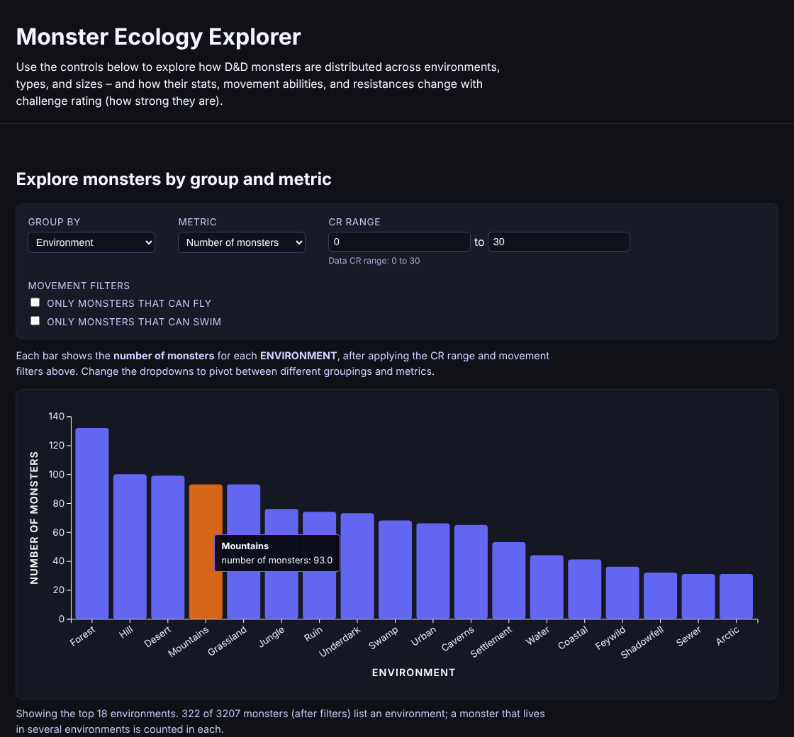

# Monster Ecology Explorer

**[Live site →](https://mam084.github.io/MonsterEcology/)**

An interactive D3 dashboard exploring the "ecology" of 3,200+ Dungeons & Dragons monsters: where they live, how their stats scale with challenge rating (CR), and which damage resistances cluster in which environments.



## What you can explore

- **Monsters by group:** count, average CR, HP, or AC, or the share that can fly or swim, grouped by environment, creature type, or size. Filter by CR range and movement.
- **Stats vs. challenge rating:** scatterplot of any ability score, HP, or AC against CR with a linear fit and correlation. Click a bar in the first chart to focus on that group.
- **Damage defenses:** heatmap of how common each resistance, immunity, or vulnerability is across environments, types, or sizes.

## Findings

- **HP tracks CR closely** (r = 0.91); armor class scales more loosely (r = 0.73).
- **Flight becomes the norm at high CR:** about 24% of monsters at CR 4 or below can fly, versus 72% above CR 16.
- **Hell, tombs, and the Abyss stand out for physical resistance:** about 69% of Hell monsters, 50% of tomb dwellers, and 44% of Abyss monsters resist bludgeoning damage, far above other environments.
- Only about 10% of monsters list an environment in the source data, so environment views cover a subset; monsters listed in several environments count toward each.

## Data pipeline

```
Open5e API ──▶ fetch_monsters.py ──▶ monsters_ecology.json ──▶ json_to_csv.py ──▶ monsters_ecology.csv
                                                                                    │
                                                         main.js (live site) ◀──────┤
                                                         monsters.py (figures/) ◀───┘
```

- **`fetch_monsters.py`** pages through the [Open5e](https://open5e.com/) monsters API and parses inconsistent fields: speeds given as dicts or strings, CR as fractions ("1/4"), and free-text damage defenses and senses.
- **`json_to_csv.py`** flattens the records into a tidy CSV.
- **`main.js`** loads the CSV in the browser, normalizes environment names (e.g. "Hill" and "Hills"), and drives all three linked views.
- **`monsters.py`** produces static exploratory figures in `figures/`.

## Run locally

```bash
python3 -m http.server 8000          # then open http://localhost:8000

pip install -r requirements.txt
python fetch_monsters.py && python json_to_csv.py   # refresh the data
python monsters.py                                   # regenerate static figures
```

*Monster data from the Open5e API (D&D 5e SRD and third-party open content).*
